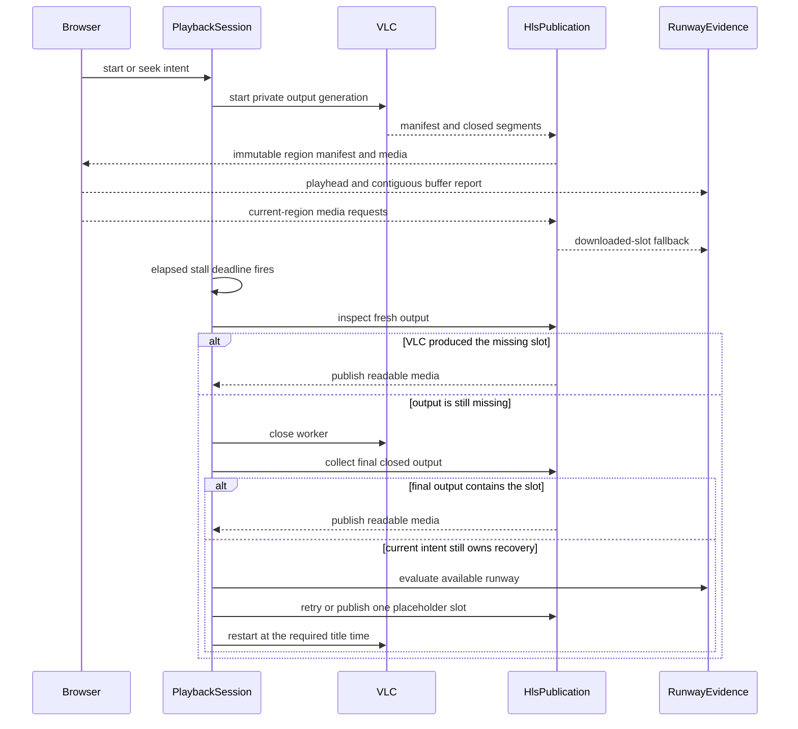

# Playback Architecture

The application supports one active DVD playback session for one viewer. The central design rule is that the component which makes a recovery decision also owns every state transition needed to complete or cancel that decision. This keeps timer callbacks, seeks, worker exits, and HLS publication from racing through shared mutable state.

## Ownership

`SessionManager` selects, reuses, replaces, and expires the active session. It delegates the lifecycle of that session to `PlaybackSessionController`, which serializes start, seek, recovery, and stop operations and owns the active VLC worker. `PlaybackSession` is the public snapshot returned to routes and the browser.

`HlsPublication` owns the mapping from fixed title-time slots to published media. VLC writes each run into a private generation directory. Publication validates complete manifest entries and media before exposing them. A slot is immutable after publication, and an explicit seek creates a new playback region with a versioned manifest URL.

`RunwayEvidence` owns the small, untrusted set of observations used to decide how long recovery can wait. It accepts current-region browser reports and records current-region segment downloads as a conservative fallback. `PlaybackTime` supplies monotonic elapsed time and cancellable scheduling; calendar time remains separate for session activity and user-visible timestamps.

The browser player owns media attachment, title-time display, seek intent, playback feedback, and cleanup. The server log and catalog UI subscribe independently to the event stream, so playback recovery does not depend on either UI being present.

## Playback and Recovery Flow



A timer wakeup is only a prompt to inspect current state. It is never proof that a DVD slot is unreadable. Recovery first rechecks output, closes the producer, and collects any final output flushed during shutdown. Only an absent or unusable slot after successful closure may consume the retry policy or become a placeholder.

Every public seek or stop advances the session's intent generation before queued work can resume. Recovery checks that generation after asynchronous boundaries and again at publication. A superseded restart worker is stopped instead of being installed, and a superseded placeholder is never advertised.

Retries stay anchored to the exact stalled title-time slot. When readable output arrives, publication advances normally. When the retry budget or available runway is exhausted, recovery fills exactly one two-second slot and restarts at the following slot. This preserves title time across damaged areas.

## Browser Runway Feedback

The player sends `POST /api/sessions/:sessionId/playback` at most once per second while active, with a heartbeat while paused. Reports are best effort and contain:

```json
{
  "manifestUrl": "/streams/session-id/index.m3u8?region=2",
  "reporterId": "stable-id-for-this-player",
  "sequence": 12,
  "positionSeconds": 418,
  "bufferedEndSeconds": 432,
  "paused": false,
  "playbackRate": 1
}
```

The server accepts a report with `204`, rejects malformed input with `400`, rejects stale region or sequence data with `409`, and returns `404` for a missing session. Reports are scoped to the raw manifest URL, expire after five seconds, and retain bounded per-reporter sequence high-water marks so reordered requests cannot become fresh again. During a source transition or server seek, the browser suppresses reports and aborts pending transport on disposal.

Runway is the contiguous playable buffer ahead of the reported playhead, adjusted for playback rate, report age, and transport uncertainty. If several active players report, the least runway wins. Paused feedback can grant only bounded patience. If no fresh report exists, recovery uses the highest segment downloaded from the current region; requests for old regions, stitched manifests, and unqualified assets do not affect the estimate.

## HLS Publication Guarantees

- Region manifests are append-only views of immutable session slots.
- A published slot keeps its first bytes for the lifetime of the session, including a placeholder.
- Segment files are prepared completely before a manifest can reference them.
- Explicit seeks close the previous region and create a new region URL; recovery extends the current region.
- Stitched manifests are immutable revision snapshots across retained ranges.
- Missing or invalid `EXTINF` entries and segments outside the configured target-duration contract remain unpublished.
- Failed asset reads do not count as activity or runway evidence.

These guarantees make every advertised manifest self-consistent, but they do not prove that synthetic MPEG-TS data is decodable. Physical-disc behavior and native Safari playback still require hardware and browser validation.

## Testing the Timing Model

Recovery tests inject a manual `PlaybackTime`. They advance a monotonic clock and run scheduled work deterministically while real filesystem publication continues normally. This separates policy deadlines from event-loop speed and allows tests to cover cancellation, final output during worker closure, restart readiness, wall-clock jumps, stale reports, and exact deadline edges without tiny real-time sleeps.

Start with [development.md](development.md) for commands and source-file pointers. The supporting decisions and primary-source research are in [recovery timing](research/2026-09-14-recovery-timing.md), [HLS publication](research/2026-09-14-hls-publication.md), [browser playback](research/2026-09-14-browser-playback.md), and the [recovery design](superpowers/specs/2026-09-14-recovery-design.md).
